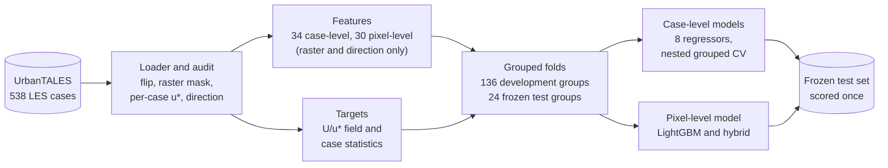

# Urban Microclimate Modelling

[](https://github.com/mahir-m01/Urban-Microclimate-Modelling/actions/workflows/ci.yml)

[](https://github.com/astral-sh/uv)
[](https://github.com/astral-sh/ruff)
[-2a78d6)](https://urbantales.vercel.app)


Surrogate models for pedestrian-level urban wind, trained on 538 large-eddy simulations of idealized building arrays and real neighbourhoods from 50 cities.

## Overview

Urban form controls how wind moves through streets. Deep street canyons trap heat and pollution, while open corridors and tall buildings create uncomfortable or unsafe gusts. High-fidelity large-eddy simulation (LES) resolves these effects, but costs thousands of CPU-hours per neighbourhood.

This project develops data-driven surrogate models. Given a building-height map and the prevailing wind direction, they predict the time-averaged wind at pedestrian height (1.75 m) in milliseconds. Every model is evaluated on cities and layout families it has never seen.

The study focuses on surrogate accuracy and uncertainty. It is not intended for safety-critical design approval.

## Objectives

- Predict neighbourhood-scale wind statistics from engineered urban-morphology features using classical machine learning (Phase 1).
- Predict full pedestrian-level wind fields from building-height maps using deep learning (Phase 2).
- Combine both approaches in a hybrid model, and quantify predictive uncertainty with calibrated intervals.
- Evaluate generalisation on held-out cities and layout families.

## Dataset

This work uses UrbanTALES (Nazarian et al., 2025), a public collection of 538 PALM large-eddy simulations of neutral atmospheric flow over urban layouts.

| Subset | Cases | Description |
| --- | --- | --- |
| Idealized | 224 | Aligned and staggered building arrays; eight plan-area densities; uniform and variable heights; two wind directions; 0.5 m grid |
| Realistic | 314 | Neighbourhoods from 50 cities in 22 countries, derived from OpenStreetMap; uniform and real building heights; 1 m grid |

Each case provides:
- a building-height raster;
- time-averaged pedestrian-level velocity and turbulence fields;
- horizontally averaged vertical profiles;
- the simulation configuration.

The data is distributed by its authors under CC BY-NC 4.0. The simulation fields are not redistributed in this repository; `data/` holds only the case catalog, the official per-case metadata table and the name map between them.

**Data quality.** An audit of every file found three issues that change downstream results. All three are handled once, in the shared loader `urbanwind.data.load_case`; details are in [`data/README.md`](data/README.md).
- The building rasters are stored upside down relative to the wind fields. Open-ground agreement is 0.71 as stored and 0.99 after a flip.
- Some files store values inside buildings. A mask built from missing values biases the mean wind of 52 cases by up to 11.7%.
- Each case has its own friction velocity $u_*$, which sets the wind scale.

## Pipeline



| Stage | Focus | Methods |
| --- | --- | --- |
| Data (S01 to S05) | Ingestion, quality control, targets, features | Catalog from the data feed, alignment and masking audit, per-case normalisation, periodic morphology, Macdonald and Kanda roughness, fetch and sheltering features |
| Phase 1: Machine learning (S06 to S09) | Area-averaged and pixel-level wind | Ridge, kNN, SVR, Gaussian processes, random forests, XGBoost, LightGBM; nested grouped cross-validation; group bootstrap; SHAP |
| Phase 2: Deep learning | Full-field wind prediction | U-Net with periodic padding, Fourier neural operators, deep ensembles |
| Hybrid | Combining both | Feature-conditioned networks (FiLM), level-anchored field prediction |

## Phase 1 results

All numbers are out-of-fold scores on 482 development cases. Each fold holds out whole cities and layout families, and hyperparameters are chosen in an inner grouped loop.

### Case level: mean wind of a neighbourhood

| Model | $U_\mathrm{mean}$ $R^2$ | idealized | realistic | $U_\mathrm{p95}$ $R^2$ |
| --- | --- | --- | --- | --- |
| XGBoost | **0.836** | 0.970 | **0.700** | **0.754** |
| LightGBM | 0.828 | 0.967 | 0.686 | 0.751 |
| Gaussian process (ARD Matérn) | 0.819 | **0.982** | 0.656 | 0.666 |
| Random forest | 0.817 | 0.966 | 0.666 | 0.749 |
| kNN | 0.690 | 0.935 | 0.439 | 0.654 |
| Ridge | 0.383 | 0.885 | -0.128 | 0.508 |
| Baseline B1: random forest, 9 basic features | 0.735 | 0.890 | 0.565 | 0.670 |

- **The ensembles are tied.** XGBoost, LightGBM and random forests cannot be separated by a group bootstrap (XGBoost minus LightGBM: 0.008 [-0.019, 0.032]), and all three beat the baseline by 0.08 to 0.10.
- **What drives the wind.** SHAP ranks frontal area, distance to walls, upwind fetch, built volume and the Kanda roughness length highest.
- **Random splits flatter models.** Random 5-fold cross-validation overstates realistic $R^2$ by 0.03 to 0.04 for tree models and by 0.45 for ridge.

<p align="center"></p>

### Field level: the wind map

| Prediction at every open cell | Pooled $R^2$ | Median per-case $R^2$ (idealized / realistic) |
| --- | --- | --- |
| True case mean everywhere (oracle) | 0.310 | 0 / 0 |
| Pixel-level LightGBM, 30 features | **0.593** | 0.457 / 0.253 |
| Hybrid: pattern times case-level mean | 0.581 | **0.478 / 0.254** |

- **Level versus pattern.** A tabular model recovers the level of each field, but only part of its pattern: corner jets, wakes and canyon vortices are smoothed, and peak winds are underpredicted.
- **The limit is the features.** A random case split does not change this, and neither do eight times more training cells. Even on its own training cases the model explains only part of the pattern.
- **Why Phase 2.** This gap is the motivation for convolutional models that read the geometry directly.

<p align="center"></p>

### Frozen test set, scored once

After all choices were fixed on the development folds, the final models were refitted on all 482 development cases and scored once on the 53 cases of the 24 frozen test groups (34 idealized, 19 realistic). Details are in [`pipeline/S09_phase1_evaluation`](pipeline/S09_phase1_evaluation).

| Model | $U_\mathrm{mean}$ $R^2$ | idealized | realistic |
| --- | --- | --- | --- |
| SVR (RBF) | 0.884 | 0.976 | 0.737 |
| Random forest | 0.871 | 0.984 | 0.690 |
| LightGBM | 0.867 | 0.989 | 0.673 |
| XGBoost | 0.848 | 0.990 | 0.623 |
| Baseline B1 | 0.790 | 0.918 | 0.571 |
| Pixel-level LightGBM (pooled field $R^2$) | 0.676 | 0.892 | 0.612 |

- Every non-linear model again beats the baseline, and the field models reproduce the development picture.
- With only 19 realistic test cases, the test set confirms generalisation but cannot rank models that differ by a few hundredths. The development group bootstrap over 482 cases, which finds the leading models tied, is the evidence for ranking.

## Repository structure

```text
Urban-Microclimate-Modelling/
├── data/                           case catalog, metadata, name map, frozen splits
├── src/urbanwind/                  shared package: loader, metrics, evaluator, splits, features
├── pipeline/
│   ├── S01_data_ingestion/         catalog builder and downloader
│   ├── S02_preprocessing/          profile preprocessing and case-level targets
│   ├── S03_splits_evaluation/      grouped splits and evaluation protocol
│   ├── S04_eda/                    exploratory analysis and quality checks
│   ├── S05_feature_engineering/    case- and pixel-level features
│   ├── S06_case_models/            case-level models (S06a first run, S06c comparison)
│   ├── S06b_feature_selection_AS/  feature selection and PCA study
│   ├── S07_pixel_model/            pixel-level model and diagnostics
│   └── S09_phase1_evaluation/      one-time scoring of the frozen test set
├── results/                        experiment log (runs.csv); predictions are not tracked
├── .github/workflows/              lint and tests on every pull request
├── pyproject.toml, uv.lock         pinned environment
└── README.md
```

Each stage folder contains its scripts or notebooks, a stage summary and the outputs that later stages build on.

## Citation

This project builds on the UrbanTALES dataset:

> Nazarian, N., Lu, J., Lipson, M., Hart, M. A., Liu, S., Krayenhoff, E. S., Blunn, L., and Martilli, A. (2025). UrbanTALES: A Large-Eddy Simulation Dataset for Urban Canopy Layer Turbulence and Parameterization. *Bulletin of the American Meteorological Society*, 106(12). https://doi.org/10.1175/BAMS-D-25-0061.1

Related work:

> Lu, J., Li, W., Hobeichi, S., Azad, S. A., and Nazarian, N. (2025). Machine learning predicts pedestrian wind flow from urban morphology and prevailing wind direction. *Environmental Research Letters*, 20, 054006. https://doi.org/10.1088/1748-9326/adc148

> Kanda, M., Inagaki, A., Miyamoto, T., Gryschka, M., and Raasch, S. (2013). A New Aerodynamic Parametrization for Real Urban Surfaces. *Boundary-Layer Meteorology*, 148, 357–377. https://doi.org/10.1007/s10546-013-9818-x

## Acknowledgements

Developed as a semester project in Advanced Machine Learning and Deep Learning. Simulation data courtesy of the UrbanTALES team at UNSW Sydney.
