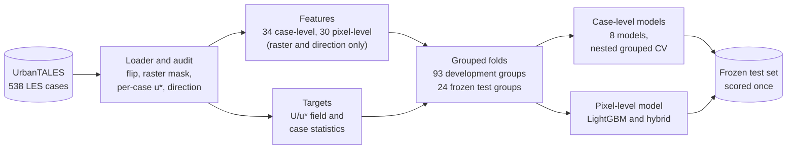
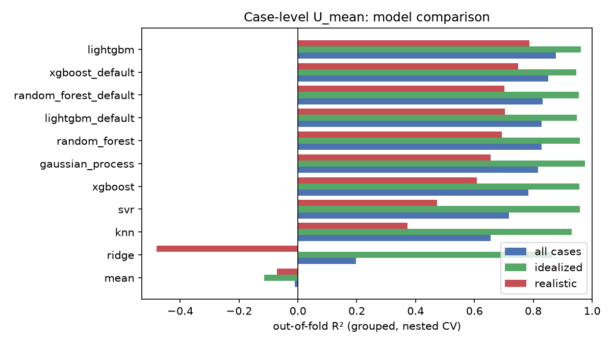
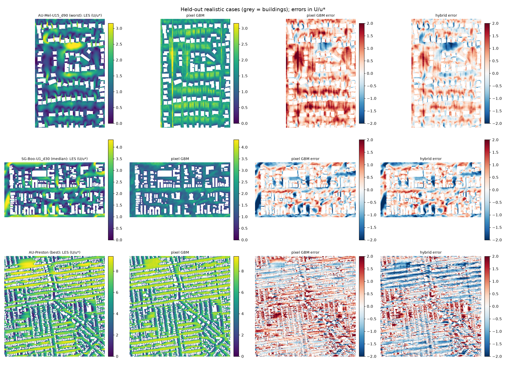

# Urban Microclimate Modelling

[](https://github.com/mahir-m01/Urban-Microclimate-Modelling/actions/workflows/ci.yml)
[](https://www.python.org/)
[](https://github.com/astral-sh/uv)
[](https://github.com/astral-sh/ruff)
[](https://urbantales.vercel.app)
[](https://creativecommons.org/licenses/by-nc/4.0/)


Surrogate models for pedestrian-level urban wind, trained on 538 large-eddy simulations of idealized building arrays and real neighbourhoods in 22 countries.

## Overview

Urban form controls how wind moves through streets. Deep street canyons trap heat and pollution, while open corridors and tall buildings create uncomfortable or unsafe gusts. High-fidelity large-eddy simulation (LES) resolves these effects, but costs thousands of CPU-hours per neighbourhood.

This project develops data-driven surrogate models. Given a building-height map and the prevailing wind direction, they predict the time-averaged wind at pedestrian height (1.75 m) in milliseconds. Every model is evaluated on cities and layout families it has never seen.

The study focuses on surrogate accuracy and uncertainty. It is not intended for safety-critical design approval.

## Objectives

- Predict neighbourhood-scale wind statistics from engineered urban-morphology features using classical machine learning (Phase 1).
- Predict full pedestrian-level wind fields from building-height maps using deep learning (Phase 2).
- Combine both approaches in a hybrid model, and quantify predictive uncertainty with calibrated intervals.
- Evaluate generalisation on held-out cities and layout families.

## Dataset

This work uses UrbanTALES (Nazarian et al., 2025), a public collection of 538 PALM large-eddy simulations of neutral atmospheric flow over urban layouts.

| Subset | Cases | Description |
| --- | --- | --- |
| Idealized | 224 | Aligned and staggered building arrays; eight plan-area densities; uniform and variable heights; two wind directions; 0.5 m grid |
| Realistic | 314 | Neighbourhoods in 22 countries (50 city codes), derived from OpenStreetMap; uniform and real building heights; 1 m grid (0.5 m for 5 cases) |

Each case provides:
- a building-height raster;
- time-averaged pedestrian-level velocity and turbulence fields;
- horizontally averaged vertical profiles;
- the simulation configuration.

The data is distributed by its authors under CC BY-NC 4.0. The simulation fields are not redistributed in this repository; `data/` holds only the case catalog, the official per-case metadata table and the name map between them.

**Data quality.** An audit of every file found four issues that change downstream results. All are handled once, in the shared loader `urbanwind.data.load_case`; details are in [`data/README.md`](data/README.md) and [`pipeline/S02_preprocessing`](pipeline/S02_preprocessing).
- The building rasters are stored upside down relative to the wind fields. Open-ground agreement is 0.71 as stored and 0.99 after a flip.
- Some files store values inside buildings, so open ground is taken from the raster, not from missing values.
- Some open-ground cells hold a time-mean speed of exactly zero: the simulation treated them as buildings. They are left out (284 of 292 realistic development cases have some). Together with the raster mask, this changes the mean wind of 59 development cases by more than 1%, by up to 14.6%.
- Each case has its own friction velocity $u_*$, which sets the wind scale.

## Pipeline



| Stage | Focus | Methods |
| --- | --- | --- |
| Data (S01 to S05) | Ingestion, quality control, targets, features | Catalog from the data feed, alignment and masking audit, per-case normalisation, periodic morphology, Macdonald and Kanda roughness, fetch and sheltering features |
| Phase 1: Machine learning (S06 to S09) | Area-averaged and pixel-level wind | Ridge, kNN, SVR, Gaussian processes, random forests, XGBoost, LightGBM; nested grouped cross-validation; group bootstrap; SHAP |
| Phase 2: Deep learning | Full-field wind prediction | U-Net with periodic padding, Fourier neural operators, deep ensembles |
| Hybrid | Combining both | Feature-conditioned networks (FiLM), level-anchored field prediction |

## Phase 1 results

All development numbers are out-of-fold scores on 482 development cases. Each fold holds out whole cities and layout families (93 groups), and hyperparameters are chosen in an inner grouped loop. The numbers below follow the pipeline audit of 27 October 2026, which corrected the features, the targets and the development groups.

### Case level: mean wind of a neighbourhood

| Model | $U_\mathrm{mean}$ $R^2$ | idealized | realistic | $U_\mathrm{p95}$ $R^2$ |
| --- | --- | --- | --- | --- |
| LightGBM | **0.876** | 0.961 | **0.787** | **0.767** |
| Random forest | 0.828 | 0.958 | 0.694 | 0.725 |
| Gaussian process (ARD Matérn) | 0.816 | **0.976** | 0.655 | 0.710 |
| XGBoost | 0.784 | 0.956 | 0.608 | 0.723 |
| SVR (RBF) | 0.717 | 0.958 | 0.472 | 0.700 |
| kNN | 0.655 | 0.930 | 0.373 | 0.668 |
| Ridge | 0.197 | 0.864 | -0.480 | 0.380 |
| Baseline B1: random forest, 9 basic features | 0.742 | 0.881 | 0.587 | 0.660 |

- **LightGBM leads.** It beats the baseline by 0.135 R² [0.095, 0.178] (95% group-bootstrap interval), and the random forest by 0.048 [0.005, 0.099]. The gains of tuned XGBoost and the Gaussian process over the baseline are not significant.
- **Tuning can help or hurt.** With default settings XGBoost (0.851) and LightGBM (0.829) are tied. Tuning lifts LightGBM, but XGBoost's inner search picks settings that fail on two very open neighbourhoods whose cities are held out with them.
- **What drives the wind.** SHAP ranks distance to walls, frontal area, upwind and lateral fetch, and built volume highest.
- **Random splits flatter models.** Random 5-fold cross-validation overstates realistic $R^2$ by up to 0.04 for tree models and by 0.61 for ridge.

<p align="center"></p>

### Field level: the wind map

| Prediction at every open cell | Pooled $R^2$ | Median per-case $R^2$ (idealized / realistic) | Median NRMSE |
| --- | --- | --- | --- |
| True case mean everywhere (oracle) | 0.311 | 0 / 0 | 0.549 |
| Pixel-level LightGBM, 30 features | **0.591** | 0.418 / 0.247 | 0.468 |
| Hybrid: pattern times case-level mean | 0.576 | **0.431 / 0.251** | **0.467** |

- **Level versus pattern.** A tabular model recovers the level of each field, but only part of its pattern: corner jets, wakes and canyon vortices are smoothed, and peak winds are underpredicted.
- **The limit is the features.** A random case split changes this little. A far less regularised model fits its training cases better but scores no better on unseen ones.
- **Why Phase 2.** This gap is the motivation for convolutional models that read the geometry directly.

<p align="center"></p>

### Frozen test set

After all choices were fixed on the development folds, the final models were refitted on all 482 development cases and scored on the 53 cases of the 24 frozen test groups (34 idealized, 19 realistic). The test set was first scored on 26 October 2026 and scored a second time on 27 October 2026, after the pipeline audit; no test score was used for any choice, and `pipeline/S09_phase1_evaluation/outputs/test_scored.json` records both runs and the reason. Details are in [`pipeline/S09_phase1_evaluation`](pipeline/S09_phase1_evaluation).

| Model | $U_\mathrm{mean}$ $R^2$ | idealized | realistic |
| --- | --- | --- | --- |
| Gaussian process | 0.931 | 0.985 | 0.843 |
| XGBoost | 0.898 | 0.975 | 0.772 |
| Random forest | 0.883 | 0.971 | 0.740 |
| kNN | 0.870 | 0.959 | 0.723 |
| LightGBM | 0.865 | 0.974 | 0.690 |
| SVR (RBF) | 0.857 | 0.974 | 0.669 |
| Baseline B1 | 0.827 | 0.919 | 0.666 |
| Pixel-level LightGBM (pooled field $R^2$) | 0.680 | 0.893 | 0.617 |

- Every non-linear model beats the baseline, including kNN and SVR, which were below it in development, and the field models reproduce the development picture.
- The order of the leading models differs from development: with only 19 realistic test cases, a few cases decide it. The test set confirms generalisation but cannot rank close models; the development comparison over 482 cases is the evidence for ranking.

## Repository structure

```text
Urban-Microclimate-Modelling/
├── data/                           case catalog, metadata, name map, frozen splits
├── src/urbanwind/                  shared package: loader, metrics, evaluator, splits, features
├── pipeline/
│   ├── S01_data_ingestion/         catalog builder and downloader
│   ├── S02_preprocessing/          profile preprocessing and case-level targets
│   ├── S03_splits_evaluation/      grouped splits and evaluation protocol
│   ├── S04_eda/                    exploratory analysis and quality checks
│   ├── S05_feature_engineering/    case- and pixel-level features
│   ├── S06_case_models/            case-level models (S06a first run, S06c comparison)
│   ├── S06b_feature_selection_AS/  feature selection and PCA study
│   ├── S07_pixel_model/            pixel-level model and diagnostics
│   └── S09_phase1_evaluation/      one-time scoring of the frozen test set
├── results/                        experiment log (runs.csv; runs_v1.csv is the log before the metric columns were corrected); predictions are not tracked
├── .github/workflows/              lint and tests on every pull request
├── pyproject.toml, uv.lock         pinned environment
└── README.md
```

Each stage folder contains its scripts or notebooks, a stage summary and the outputs that later stages build on.

## Citation

This project builds on the UrbanTALES dataset:

> Nazarian, N., Lu, J., Lipson, M., Hart, M. A., Liu, S., Krayenhoff, E. S., Blunn, L., and Martilli, A. (2025). UrbanTALES: A Large-Eddy Simulation Dataset for Urban Canopy Layer Turbulence and Parameterization. *Bulletin of the American Meteorological Society*, 106(12). https://doi.org/10.1175/BAMS-D-25-0061.1

Related work:

> Lu, J., Li, W., Hobeichi, S., Azad, S. A., and Nazarian, N. (2025). Machine learning predicts pedestrian wind flow from urban morphology and prevailing wind direction. *Environmental Research Letters*, 20, 054006. https://doi.org/10.1088/1748-9326/adc148

> Kanda, M., Inagaki, A., Miyamoto, T., Gryschka, M., and Raasch, S. (2013). A New Aerodynamic Parametrization for Real Urban Surfaces. *Boundary-Layer Meteorology*, 148, 357–377. https://doi.org/10.1007/s10546-013-9818-x

## Acknowledgements

Developed as a semester project in Advanced Machine Learning and Deep Learning. Simulation data courtesy of the UrbanTALES team at UNSW Sydney.
